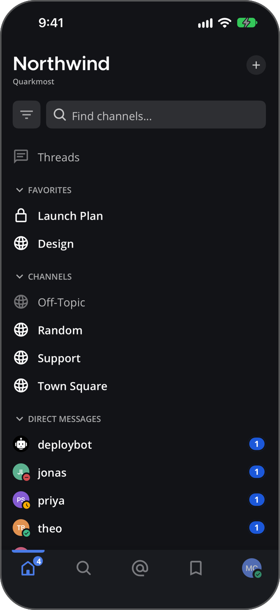
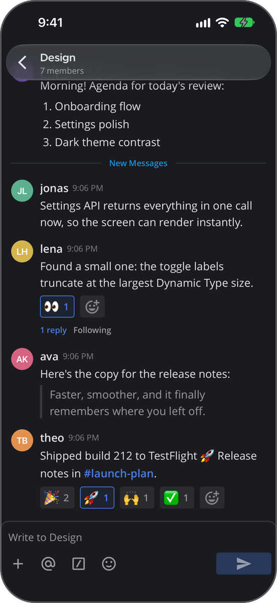
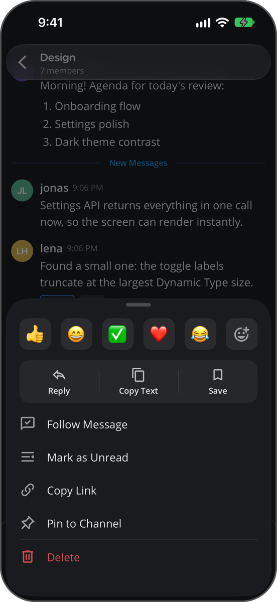
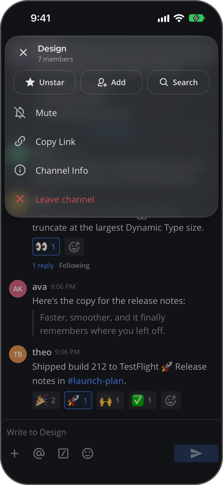
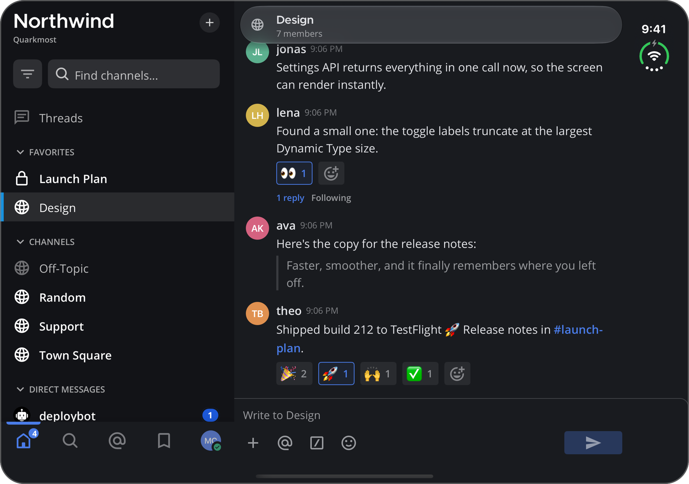
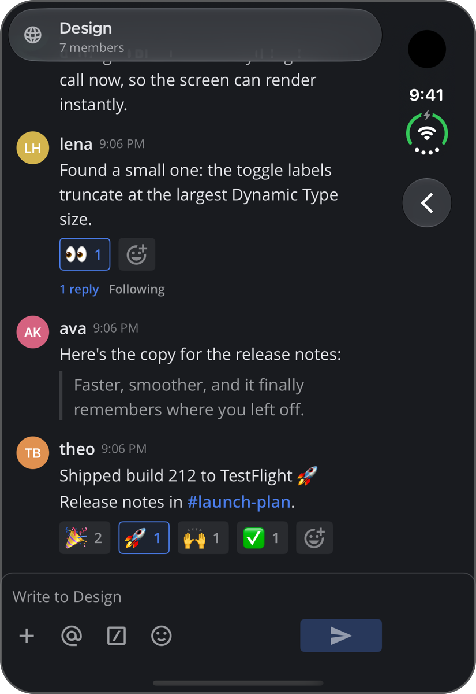

# Quarkmost

An **unofficial** native iOS client for [Mattermost](https://mattermost.com)® servers. It's a Swift/UIKit
port of the open-source [Mattermost Mobile](https://github.com/mattermost/mattermost-mobile) app.

> [!IMPORTANT]
> **This is a personal project.** I maintain it for myself and a few friends, and that's all.
>
> - **Feature parity with the official app is not a goal, and not guaranteed.** Features get ported when
>   *we* need them, and the app may break against servers or setups that we don't use.
> - **No support is offered.** I will probably ignore issues and pull requests. Fork it if you want changes.
> - **Quarkmost is not affiliated with, sponsored by, or endorsed by Mattermost, Inc.** Please don't send
>   them reports about it.
> - **Please support the original team** (see [below](#support-the-original-team)). For almost
>   everyone, the official app is the right choice.
> - **100% AI** If this bothers you, you should stay far, far way because I cannot vouch for _any_ of the code. 

## Screenshots

### iPhone

| Channels | Conversation | Message actions | Channel menu |
| :---: | :---: | :---: | :---: |
|  |  |  |  |

### iPhone Duo

| Unfolded | Folded |
| :---: | :---: |
|  |  |

Taken on a local test server. The team, people and messages are made up.

## What's different from the official app

The app is mostly the same. The screens, layout, themes and behaviour were ported by reading the official app's
source, so it should look and feel familiar. The differences:

- **Performance.** Everything loads a lot faster. The message list is native UIKit, with message layout done off the main thread. It also scrolls at the full refresh rate on ProMotion iPhones.
- **Swipe to reply.** Swipe a message to the left to reply to it. As in the official app, tapping a message
  also opens its thread.
- **Glass header.** A floating Liquid Glass title bar that messages scroll under. Tap it for channel
  actions. On the iPhone Duo, Back sits in the status-bar column, where iOS keeps it clear of the
  Dynamic Island.
- **iPhone Duo support.** On the inner screen of the foldable iPhone, the channel list and the conversation
  sit side by side. Opening a thread slides the list away so the thread gets the full width. Folding and
  unfolding keeps your place, your draft and any open thread.

## What's missing

See [PARITY.md](PARITY.md) for the full feature-by-feature list. In short, these aren't included:

- **Not ported:** Calls, Playbooks, Boards, AI agents, channel bookmarks, scheduled posts, message priority,
  LaTeX, and interactive message buttons and app dialogs.
- **Sign-in:** username or email plus password (with MFA) only. There's no SSO (SAML, OpenID, GitLab…) and
  no multi-server support.
- **Devices:** iPhone only. There's no iPad layout and no Android version.

## Server compatibility

- **Server version:** Mattermost server **9.11 or newer**. That's the minimum required by the official app
  version this was ported from. It's developed and used against **11.x**, so older servers are untested.
- **Collapsed Reply Threads:** works with the server setting on or off. With it off, replies show inline
  in the channel, as the official app does.
- **Push notifications:** these need some setup on the server. The official app's push service only works for
  the official app. See [docs/NOTIFICATIONS.md](docs/NOTIFICATIONS.md).

## Using it

There are no App Store or TestFlight links. To use it, build and sign it under your own Apple developer
account:

- **[docs/DEPLOY.md](docs/DEPLOY.md):** building it, putting it on your phone or TestFlight, and staying
  within the licenses.
- **[docs/NOTIFICATIONS.md](docs/NOTIFICATIONS.md):** getting push notifications working without breaking them
  for people on the official app.

## Support the original team

Quarkmost only exists because Mattermost publishes its mobile app under an open-source license. If you
use Mattermost:

- Use the [official apps](https://mattermost.com/download/). They're maintained, supported and complete.
- If your organisation relies on Mattermost, consider a [paid plan](https://mattermost.com/pricing/).
- Report bugs and contribute fixes [upstream](https://github.com/mattermost/mattermost-mobile).

## License

Quarkmost is licensed under the [Apache License 2.0](LICENSE). It's a derivative of Mattermost Mobile
(Copyright 2015-present Mattermost, Inc., Apache License 2.0). See [NOTICE](NOTICE) for attribution, changes
and bundled assets.

"Mattermost" is a trademark of Mattermost, Inc., used here only to describe what this app connects to.
The app's name and icon are deliberately not Mattermost's.
